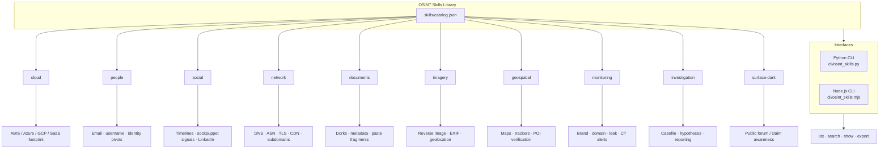
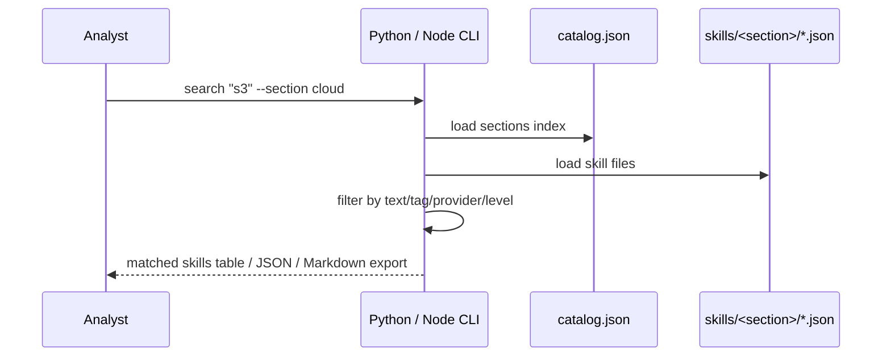

<div align="center">

# OSINT Skills Library

**Large, multi-section OSINT playbook library for investigations — including Cloud search**

[](skills/catalog.json)
[](#library-map)
[](cli/osint_skills.py)
[](cli/osint_skills.mjs)
[](LICENSE)

Searchable skills for **Cloud · People · Social · Network · Documents · Imagery · Geospatial · Monitoring · Investigation · Surface/Dark-edge**

</div>

---

## Library map



---

## What's inside

| Section | Focus |
| --- | --- |
| `cloud` | Cloud OSINT & public cloud search (AWS/Azure/GCP/SaaS) |
| `people` | Identity, email, username, career trails |
| `social` | Social platforms, timelines, alt-account signals |
| `network` | DNS, ASN, TLS, CDN, passive subdomains |
| `documents` | Document dorking, metadata, version diffs |
| `imagery` | Reverse image, EXIF, visual geo, media checks |
| `geospatial` | Maps, public trackers, place verification |
| `monitoring` | Brand/domain/leak/certificate watches |
| `investigation` | Casefile method, evidence, reporting |
| `surface-dark` | Public-edge awareness (no illicit access guidance) |

Each skill includes: summary, objective, steps, example queries, tools, outputs, ethics.

---

## Install

```bash
git clone https://github.com/moataz-younes/osint-cloud-skills.git
cd osint-cloud-skills
```

No mandatory dependencies for either CLI:

- **Python 3.10+** or
- **Node.js 18+**

---

## Usage

### Python

```bash
python cli/osint_skills.py sections
python cli/osint_skills.py list --section cloud
python cli/osint_skills.py search bucket --section cloud
python cli/osint_skills.py list --tag dns
python cli/osint_skills.py show public-bucket-osint
python cli/osint_skills.py export --section network -o network-pack.md
```

### Node.js

```bash
node cli/osint_skills.mjs sections
node cli/osint_skills.mjs list --section people
node cli/osint_skills.mjs search username
node cli/osint_skills.mjs show email-pivot
node cli/osint_skills.mjs export -o cloud-pack.md --section cloud
```

---

## How searching works



---

## Repository layout

```text
osint-cloud-skills/
├── skills/
│   ├── catalog.json          # section index
│   ├── cloud/*.json
│   ├── people/*.json
│   ├── social/*.json
│   ├── network/*.json
│   ├── documents/*.json
│   ├── imagery/*.json
│   ├── geospatial/*.json
│   ├── monitoring/*.json
│   ├── investigation/*.json
│   └── surface-dark/*.json
├── cli/
│   ├── osint_skills.py       # Python interface
│   └── osint_skills.mjs      # Node.js interface
├── docs/
│   └── ARCHITECTURE.md
└── README.md
```

---

## Add a new skill

1. Pick a section folder under `skills/`
2. Add `my-skill-id.json` using the same schema as existing files
3. Update that section’s `_section.json` skill list (or regenerate via `_generate_library.py`)
4. Bump counts in `skills/catalog.json`

---

## Ethics

Built for **authorized investigations, defense, education, and research**.  
Skills emphasize public sources and responsible disclosure — not unauthorized access.

---

## Author

**Moataz Younes** — Cybercrime Investigator · OSINT · Cybersecurity  
GitHub: [moataz-younes](https://github.com/moataz-younes)

## License

MIT — see [LICENSE](LICENSE)
