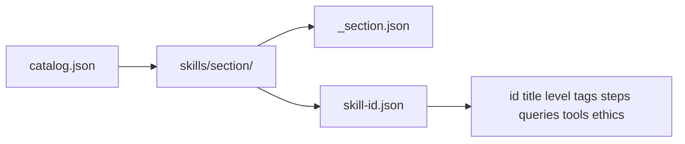

# Architecture

## Goal

Provide a **large, sectioned OSINT skills library** that investigators can search and export during cloud and general OSINT work — with more than one CLI language.

## Components

1. **Skill packs (data)** — JSON files grouped by section under `skills/`
2. **Catalog** — `skills/catalog.json` is the map of sections
3. **Python CLI** — `cli/osint_skills.py`
4. **Node.js CLI** — `cli/osint_skills.mjs`

Both CLIs read the same data. Adding a skill never requires rewriting program logic.

## Section model

## Why JSON files per skill?

- Easy pull requests per skill
- Simple diffs in GitHub
- Language-agnostic content (Python, Node, future Go/Rust CLIs can reuse the same packs)

## Extension points

- New section = new folder + catalog entry
- New interface = any language that can read JSON
- Export packs for casefiles (`md` / `json`)
